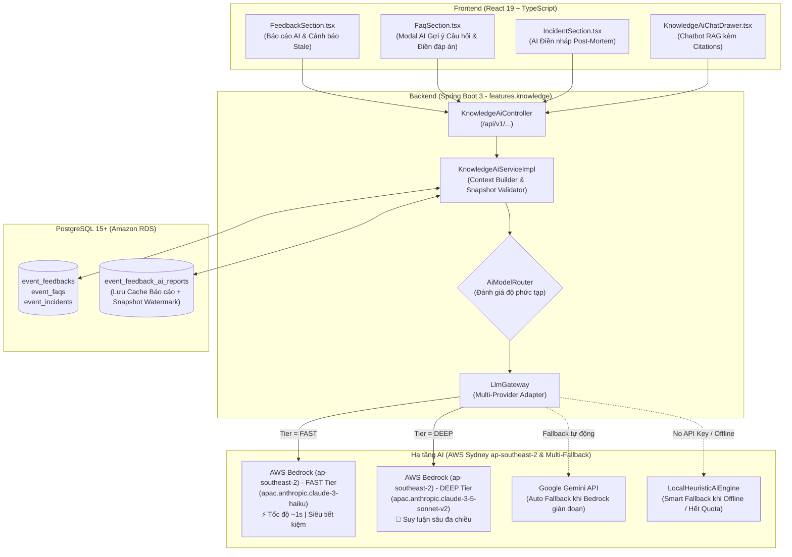

# Kiến Trúc AI Agent & Chatbot Đa Mùa (`docs/AI_AGENT_ARCHITECTURE.md`)

Tài liệu này mô tả tổng quan ý tưởng nghiệp vụ, kiến trúc kỹ thuật, chiến lược định tuyến Model tiết kiệm chi phí trên **Amazon Bedrock**, và cơ chế lưu trữ báo cáo chống dữ liệu lỗi thời (**Snapshot Staleness Detection**) cho phân hệ **Kho Tri Thức & Kinh Nghiệm Đa Mùa (`features.knowledge`)** của **Project F**.

---

## 1. Mục Tiêu Nghiệp Vụ & 4 Khả Năng Cốt Lõi Của AI Agent

Trong quá trình tổ chức sự kiện Câu lạc bộ qua nhiều mùa (`event_series` $\rightarrow$ `events`), Ban Tổ Chức (BTC) thường gặp 4 điểm nghẽn lớn:
1. **Quá tải dữ liệu Feedback sau sự kiện**: Hàng trăm phiếu khảo sát Excel được import vào `event_feedbacks` với nhiều câu hỏi thang điểm 5/10 và hàng loạt ý kiến tự luận (`custom_responses` kiểu `JSONB`). Người đọc rất khó nắm bắt nhanh bức tranh tổng thể và chuyển hóa thành hành động cho từng Ban.
2. **Thiếu bộ câu hỏi FAQ chuẩn bị trước sự kiện**: Khi mở đơn đăng ký mùa mới, BTC mất nhiều thời gian dự đoán các thắc mắc của người tham gia để xây dựng kho `event_faqs`.
3. **Báo cáo sự cố Post-Mortem sơ sài**: Thành viên gặp sự cố tại hiện trường thường chỉ ghi nhận hiện tượng bề nổi mà lúng túng khi phân tích **Nguyên nhân cốt lõi (`root_cause`)**, **Giải pháp tức thời (`immediate_solution`)** và **Bài học kế thừa (`lesson_learned`)** trong `event_incidents`.
4. **Tra cứu tri thức phân mảnh**: Thành viên BTC mới phải lục tìm thủ công qua từng tab Sự cố, FAQ và Feedback của các mùa trước.

### Hệ sinh thái 4 Tính Năng AI Giải Quyết Triệt Để:

| STT | Tính năng AI | Loại Tương Tác | Đầu vào (Context Nguồn) | Đầu ra & Giá trị mang lại cho Người dùng |
| :-: | :--- | :--- | :--- | :--- |
| **1** | **AI Tổng Hợp Báo Cáo Feedback**<br/>*(Feedback Executive Report)* | **In-place Agent** + Lưu DB kèm Snapshot | Toàn bộ `event_feedbacks` của sự kiện (điểm số từng tiêu chí + các câu góp ý tự luận thực chất). | - Bản báo cáo khái quát: **Tóm tắt điều hành (Executive Summary)**, **Phân tích cảm xúc (Sentiment Breakdown)**, **Top Điểm sáng**, **Top Vấn đề cần khắc phục**.<br/>- **Khuyến nghị hành động cụ thể cho 4 Ban** (`HR`, `PLAN`, `MEDIA`, `ACADEMIC`).<br/>- **1-Click tạo bản nháp Sự cố Post-Mortem** từ các phàn nàn lặp lại nhiều lần. |
| **2** | **AI Gợi Ý Câu Hỏi FAQ Dự Kiến**<br/>*(FAQ Question Brainstormer)* | **In-place Agent** *(Human-in-the-loop)* | Thông tin sự kiện, danh sách `event_incidents`, `event_feedbacks` và các `event_faqs` đã có (để chống trùng lặp). | - Sinh danh sách các **Câu hỏi tiềm năng có khả năng xuất hiện cao**, phân loại sẵn theo Danh mục (`category`), lý do quan trọng (`rationale`) và gợi ý khung trả lời (`answerHint`).<br/>- **Quản trị viên sự kiện trực tiếp điền câu trả lời chính thức** và lưu hàng loạt vào kho FAQ. |
| **3** | **AI Trợ Lý Phân Tích Sự Cố 5-Whys**<br/>*(Post-Mortem Copilot)* | **In-place Agent** *(Form Auto-Draft)* | 1 câu mô tả hiện tượng sự cố ngắn gọn từ thành viên BTC + bối cảnh sự kiện. | - Tự động đề xuất Mức độ nghiêm trọng (`LOW` $\rightarrow$ `CRITICAL`), các Ban liên quan (`department_enum[]`).<br/>- Điền nháp chuẩn chỉnh 4 mục bắt buộc: `description`, `rootCause`, `immediateSolution`, `lessonLearned` để người dùng chỉnh sửa trước khi lưu. |
| **4** | **Chatbot Hỏi - Đáp Kho Tri Thức (RAG)**<br/>*(Multi-Season Knowledge Assistant)* | **Conversational Chatbot** *(Drawer)* | Truy xuất ngữ cảnh thực tế từ cả 3 bảng: `event_faqs`, `event_incidents`, `event_feedbacks`. | - Trả lời tự nhiên mọi câu hỏi của BTC về quy định, bài học kinh nghiệm mùa trước và đánh giá của người tham dự.<br/>- Đính kèm **Trích dẫn nguồn (Citations)** minh bạch để chống ảo giác (Hallucination). |

---

## 2. Kiến Trúc Kỹ Thuật & Định Tuyến Model Tiết Kiệm Chi Phí (`AiModelRouter`)

### 2.1. Sơ Đồ Luồng Xử Lý Tổng Thể (RAG + Dynamic Model Routing)



### 2.2. Chiến Lược Định Tuyến Model Theo Độ Khó (`AiModelRouter`)

Trên **Amazon Bedrock**, chi phí được tính theo từng 1.000 Input/Output Tokens. Giữa model nhanh (`Claude 3 Haiku` / `Amazon Nova Lite`) và model suy luận sâu (`Claude 3.5 Sonnet` / `Claude 3 Opus`), mức chênh lệch chi phí lên tới **12 – 60 lần**.

Để tối ưu hóa chi phí đám mây theo đúng tinh thần **AWS Well-Architected Framework (Cost Optimization Pillar)**, `AiModelRouter` tự động phân loại mọi yêu cầu trước khi gọi LLM:

1. **Định tuyến vào `FAST` Tier (`anthropic.claude-3-haiku-20240307-v1:0` / `amazon.nova-lite-v1:0`)**:
   - **Tác vụ**: Điền nháp 1 sự cố đơn lẻ (`ai-draft`), Gợi ý danh sách câu hỏi FAQ (`ai-suggest`), Tổng hợp Feedback quy mô nhỏ (`< 25` phiếu khảo sát).
   - **Chatbot**: Các câu hỏi ngắn, tra cứu trực tiếp thông tin thực tế (ví dụ: *"Lệ phí tham dự là bao nhiêu?"*, *"Có bao nhiêu sự cố mức độ nghiêm trọng?"*).
2. **Định tuyến vào `DEEP` Tier (`anthropic.claude-3-5-sonnet-20241022-v2:0` / `anthropic.claude-3-opus-20240229-v1:0`)**:
   - **Tác vụ**: Tổng hợp Báo cáo Feedback quy mô lớn (`>= 25` phiếu khảo sát hoặc khối lượng góp ý tự luận `> 3.000` ký tự) đòi hỏi phân tích nguyên nhân sâu và lập kế hoạch hành động cho 4 Ban.
   - **Chatbot**: Các câu hỏi phức tạp có chứa yêu cầu phân tích tổng hợp, so sánh đa mùa hoặc hoạch định chiến lược (phát hiện qua độ dài câu hỏi và tập từ khóa phân tích: *"tại sao"*, *"nguyên nhân gốc rễ"*, *"so sánh"*, *"chiến lược"*, *"kế hoạch khắc phục"*).

---

## 3. Cơ Chế Lưu Trữ Báo Cáo AI & Phát Hiện Dữ Liệu Mới (`Snapshot Staleness Detection`)

Để tránh việc mỗi thành viên mở tab Feedback lại kích hoạt một lệnh gọi AI tốn phí trên AWS Bedrock, kết quả báo cáo tổng hợp được lưu trữ bền vững trong bảng `event_feedback_ai_reports` trên Amazon RDS PostgreSQL.

Tuy nhiên, dữ liệu khảo sát trong `event_feedbacks` có thể được cập nhật thêm (ví dụ: Admin import thêm file Excel đợt 2). Hệ thống giải quyết bài toán đồng bộ này bằng kỹ thuật **Snapshot Watermark**:

- Khi AI tạo báo cáo tại thời điểm $T_1$, bảng `event_feedback_ai_reports` ghi nhận:
  - `feedback_count_snapshot`: Tổng số phiếu khảo sát lúc tạo báo cáo (ví dụ: `45` phiếu).
  - `latest_feedback_at_snapshot`: Thời điểm `MAX(submitted_at)` của các phiếu khảo sát lúc đó.
- Khi người dùng truy cập trang (`GET /api/v1/events/{eventId}/feedbacks/ai-report`) tại thời điểm $T_2$:
  - Backend đối chiếu Snapshot đã lưu với `COUNT(*)` và `MAX(submitted_at)` hiện tại của bảng `event_feedbacks`:
    - **Nếu không có phiếu mới (`isStale = false`)**: Trả về ngay bản báo cáo từ PostgreSQL với độ trễ `< 20ms` và **chi phí AI = $0**.
    - **Nếu có phiếu mới được thêm vào (`isStale = true`, `newFeedbackCountDelta > 0`)**: Vẫn hiển thị bản báo cáo hiện có để người dùng đọc ngay, đồng thời hiển thị cảnh báo trực quan: *"Có thêm X phiếu khảo sát mới kể từ lần tổng hợp trước"*. Chỉ khi người quản trị bấm nút **"🔄 Tổng hợp lại báo cáo AI"**, hệ thống mới gọi AWS Bedrock và cập nhật (`UPSERT`) bản báo cáo mới.

---

## 4. Hướng Dẫn Cấu Hình Biến Môi Trường (AWS Bedrock / Gemini / Smart Fallback)

Hệ thống hỗ trợ 3 chế độ hoạt động linh hoạt thông qua cấu hình trong `application.yml` hoặc biến môi trường:

```yaml
app:
  ai:
    # Chọn: bedrock | gemini | heuristic (Khi provider=bedrock bị lỗi/timeout sẽ tự động fallback sang Gemini rồi về LocalHeuristicAiEngine)
    provider: ${AI_PROVIDER:bedrock}
    bedrock:
      region: ${AWS_BEDROCK_REGION:ap-southeast-2}
      fast-model-id: ${BEDROCK_FAST_MODEL_ID:apac.anthropic.claude-3-haiku-20240307-v1:0}
      deep-model-id: ${BEDROCK_DEEP_MODEL_ID:apac.anthropic.claude-3-5-sonnet-20241022-v2:0}
    gemini:
      api-key: ${GEMINI_API_KEY:}
      fast-model-id: ${GEMINI_FAST_MODEL_ID:gemini-2.5-flash}
      deep-model-id: ${GEMINI_DEEP_MODEL_ID:gemini-2.5-pro}
```

- **Trên AWS ECS Fargate (`ap-southeast-1` gọi Bedrock Sydney `ap-southeast-2`)**: Gắn quyền `bedrock:InvokeModel` vào `project-f-ecs-task-role`, đặt `AI_PROVIDER=bedrock` và `AWS_BEDROCK_REGION=ap-southeast-2`. Nếu Bedrock quá tải hoặc gián đoạn, `LlmGateway` tự động chuyển tiếp liền mạch sang `GEMINI_API_KEY` (nạp từ AWS SSM Parameter Store).
- **Trên máy Local khi phát triển**:
  - Nếu đã cấu hình `aws configure` có quyền Bedrock: Chạy trực tiếp với AWS Bedrock.
  - Nếu dùng Gemini API miễn phí từ Google AI Studio: Đặt `AI_PROVIDER=gemini` và `GEMINI_API_KEY=...`.
  - Nếu chưa cấu hình bất kỳ khóa nào: `LocalHeuristicAiEngine` (**Smart Fallback**) sẽ tự động đảm nhận việc phân tích dữ liệu thật từ PostgreSQL để trả về kết quả chuẩn xác mà không bao giờ gây lỗi gián đoạn.
