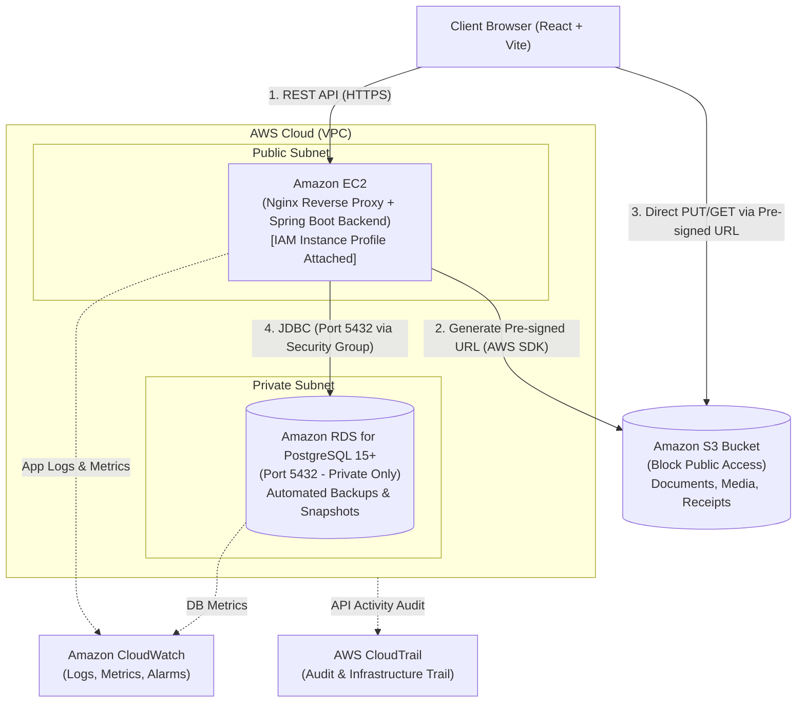
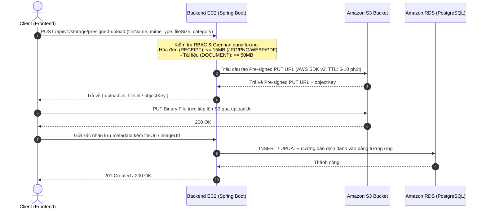

# Kiến Trúc Kỹ Thuật & Hạ Tầng Triển Khai AWS (Technical & Deployment Architecture)

Tài liệu này mô tả kiến trúc phần mềm Client-Server và thiết kế hạ tầng đám mây Cloud-Native trên nền tảng **Amazon Web Services (AWS)** cho hệ thống **Project F**.

---

## 1. Mô Hình Kiến Trúc Client-Server (Client-Server Architecture)

### 1.1. Tầng Client (Presentation Layer)
- Ứng dụng giao diện người dùng (React + TypeScript + Vite) giao tiếp với hệ thống Backend thông qua các RESTful API chuẩn hóa (HTTP/HTTPS, định dạng dữ liệu JSON).
- Tương tác trực tiếp với Amazon S3 khi tải tệp dung lượng lớn thông qua cơ chế **Pre-signed PUT/GET URL** để tối ưu hóa băng thông.

### 1.2. Tầng Backend Server (Application & Business Logic Layer)
- Xây dựng trên nền tảng **Java 21 & Spring Boot 3**, tổ chức theo kiến trúc **Package-by-Feature (Vertical Slice)** kết hợp phân tách rõ các tầng `Controller -> Service -> Repository` (3-Tier Architecture) bên trong từng feature.
- Quản lý truy cập dữ liệu bằng **Spring Data JPA / Hibernate**, hỗ trợ ánh xạ các kiểu dữ liệu nâng cao của PostgreSQL:
  - `UUID` (Khóa chính tự sinh qua `gen_random_uuid()`)
  - PostgreSQL `ENUM` (`department_enum`, `event_status_enum`, `approval_status_enum`, `incident_severity_enum`, `event_role_enum`, `club_role_enum`)
  - PostgreSQL `ARRAY` (`department_enum[]` trong bảng `event_incidents`)
  - `JSONB` (`custom_responses` trong bảng `event_feedbacks`)
  - Read-only Views (`v_event_budget_summary`, `v_projected_budget_from_previous_season`)
- Quản lý phiên bản lược đồ cơ sở dữ liệu (Database Versioning) tự động và nhất quán qua các môi trường bằng **Flyway Migration** (`V1__init_schema.sql`).
- Bảo mật ứng dụng bằng **Spring Security** kết hợp kiểm soát truy cập dựa trên vai trò cấp CLB (`club_role_enum`) và cấp sự kiện (`event_role_enum`).

---

## 2. Hạ Tầng Đám Mây AWS (AWS Cloud Services Infrastructure)

### 2.1. Mạng & Bảo mật Hạ tầng (Amazon VPC & Security Groups)
- Thiết lập mạng ảo **Amazon VPC** chia tách rõ:
  - **Public Subnet**: Chứa Reverse Proxy (Nginx) và Application Server (EC2).
  - **Private Subnet**: Chứa cơ sở dữ liệu Amazon RDS for PostgreSQL.
- Cấu hình **Security Groups** theo nguyên tắc *Least Privilege*:
  - Security Group của EC2: Chỉ mở cổng `80` (HTTP), `443` (HTTPS) cho người dùng và cổng `22` (SSH giới hạn IP quản trị).
  - Security Group của RDS Database: **Chỉ chấp nhận kết nối ở cổng `5432` từ Security Group của EC2 Application Server**, tuyệt đối không mở truy cập trực tiếp ra Internet.

### 2.2. Dịch vụ Máy chủ Ứng dụng (Amazon EC2 & IAM Role)
- Triển khai dịch vụ Backend Spring Boot trên máy chủ ảo **Amazon EC2** (sử dụng **Nginx** làm Reverse Proxy và quản lý chứng chỉ SSL/TLS).
- Gắn trực tiếp **IAM Role (EC2 Instance Profile)** cho máy chủ EC2 để cấp quyền gọi tới các dịch vụ AWS khác (như Amazon S3, Amazon CloudWatch) một cách an toàn mà **không cần lưu trữ cứng (hardcode) Access Key / Secret Key** trong mã nguồn hay file cấu hình.

### 2.3. Cơ sở Dữ liệu Quan hệ Quản lý (Amazon RDS for PostgreSQL)
- Sử dụng **Amazon RDS** chạy **PostgreSQL 15+** đặt trong Private Subnet.
- Kích hoạt tính năng sao lưu tự động (**Automated Backups**) và **Snapshot** định kỳ để bảo toàn dữ liệu tài chính và tri thức qua các nhiệm kỳ CLB.

### 2.4. Lưu trữ Đối tượng Đám mây (Amazon S3 & Luồng Pre-signed URL)
Toàn bộ tệp tĩnh dung lượng lớn bao gồm: ảnh hóa đơn chứng từ (`expense_receipts`), tài liệu kế hoạch (`event_documents`), ấn phẩm thiết kế (`event_media_assets`) và tệp đính kèm khảo sát (`event_feedbacks`) được lưu trữ tập trung trên **Amazon S3 Bucket** (chặn Public Access mặc định).

#### Luồng tải tệp lên (Pre-signed Upload Flow):

### 2.5. Giám sát, Nhật ký & Kiểm vết (Amazon CloudWatch & AWS CloudTrail)
- **Amazon CloudWatch**: Thu thập log ứng dụng từ EC2, theo dõi chỉ số hiệu năng (CPU, Memory, Disk, RDS Connections) và thiết lập cảnh báo (**CloudWatch Alarms**) khi hệ thống quá tải hoặc phát sinh lỗi `5xx`.
- **AWS CloudTrail**: Ghi nhận toàn bộ lịch sử tác động lên hạ tầng AWS và kiểm vết truy cập tài nguyên bảo mật.
