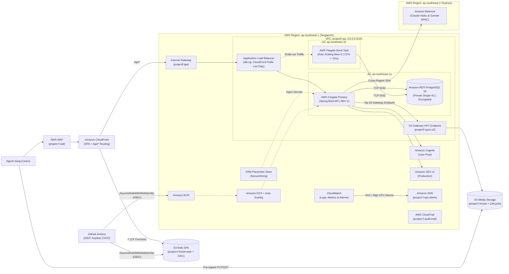

# Kiến Trúc Kỹ Thuật & Hạ Tầng Triển Khai AWS (Technical & Deployment Architecture)

Tài liệu này mô tả kiến trúc phần mềm Client-Server và thiết kế hạ tầng đám mây Cloud-Native thực tế trên nền tảng **Amazon Web Services (AWS)** cho hệ thống **Project F** (File bản vẽ Draw.io đồng bộ: `docs/aws/project-f-architecture.drawio`).

---

## 1. Mô Hình Kiến Trúc Client-Server (Client-Server Architecture)

### 1.1. Tầng Client & Edge (Presentation & CDN Security Layer)
- Ứng dụng giao diện người dùng (React 19 + TypeScript + Vite) được đóng gói dưới dạng Single Page Application (SPA), lưu trữ riêng tư trên **Amazon S3 (`project-f-fcode-web`)** với **Origin Access Control (OAC)** và phân phối toàn cầu qua **Amazon CloudFront (`E2LJYITZ24MT4R`)**.
- Bảo vệ lớp biên bởi **AWS WAF (`project-f-waf`)** với Rate Limiting (`2,000 req/5 phút/IP`), IP Reputation, Known Bad Inputs, SQLi Rule Set và Common Rule Set tinh chỉnh riêng cho REST API của Project F.
- Điều hướng SPA bằng **CloudFront Function (`project-f-spa-rewrite`)** tại `viewer-request` và định tuyến thống nhất `/api/*` về **Application Load Balancer (`project-f-alb`)** trên cùng một tên miền (loại bỏ triệt để vấn đề Mixed Content & Cookie/CORS).
- Tương tác trực tiếp với bucket lưu trữ tệp **Amazon S3 (`project-f-fcode`)** thông qua cơ chế **Pre-signed PUT/GET URL** (TTL 10 phút) để giải phóng băng thông cho tầng container Backend.

### 1.2. Tầng Backend Container (Application & Business Logic Layer)
- Xây dựng trên nền tảng **Java 21 & Spring Boot 3.3.4**, tổ chức theo kiến trúc **Package-by-Feature (Vertical Slice)** kết hợp phân tách rõ `Controller -> Service -> Repository`.
- Đóng gói Docker Image lưu trữ trên **Amazon ECR (`project-f-backend`)** và vận hành Serverless Container trên **Amazon ECS Fargate (`project-f-cluster` / `project-f-backend-service`)**.
- **Xác thực & Phân quyền**: Tích hợp **Amazon Cognito User Pool (`ap-southeast-1_UXatbaZ41`)** chuẩn OAuth2/JWT Resource Server kết hợp kiểm soát truy cập cấp CLB (`club_role_enum`) và cấp sự kiện (`event_role_enum`).
- **Tích hợp Đa Dịch Vụ Đám Mây**:
  - **Amazon SES v2** (`sealfpthackathon.io.vn` — Production Access): Gửi email thông báo và khôi phục tài khoản.
  - **Amazon Bedrock (`ap-southeast-2` — Sydney)**: Định tuyến thông minh `AiModelRouter` giữa `FAST` (`apac.anthropic.claude-3-haiku-20240307-v1:0`) và `DEEP` (`apac.anthropic.claude-3-5-sonnet-20241022-v2:0`), tự động **Multi-Provider Fallback** sang **Google Gemini API** và `LocalHeuristicAiEngine` nếu Bedrock gián đoạn.
  - **AWS Systems Manager (Parameter Store)**: Tiêm trực tiếp các biến nhạy cảm (`SecureString` KMS) vào Fargate Task lúc khởi chạy.

---

## 2. Hạ Tầng Đám Mây AWS (AWS Cloud Services Infrastructure)

### 2.1. Mạng VPC, Endpoint Nội Bộ & Security Groups (`Least Privilege`)
- **VPC (`projectf-vpc` — `10.0.0.0/16`)** trải trên 2 Availability Zones (`ap-southeast-1a`, `ap-southeast-1b`):
  - **Public Subnets** (`10.0.0.0/20`, `10.0.16.0/20`): Đặt ALB và ECS Fargate Tasks (tiết kiệm chi phí NAT Gateway).
  - **Private Subnets** (`10.0.128.0/20`, `10.0.144.0/20`): Cô lập hoàn toàn cơ sở dữ liệu Amazon RDS khỏi Internet.
  - **S3 Gateway VPC Endpoint (`projectf-vpce-s3`)**: Gắn vào cả Public và Private Route Tables, định tuyến toàn bộ lưu lượng S3 nội bộ qua mạng xương sống AWS miễn phí.
- **Chuỗi khóa Security Groups 3 lớp**:
  1. `alb-sg`: **Chỉ nhận `TCP 80` từ AWS Managed Prefix List của CloudFront (`pl-31a34658`)** — chặn mọi truy cập đi vòng qua WAF/CloudFront.
  2. `projectf-ecs-sg`: **Chỉ nhận `TCP 8080` từ `alb-sg`**, đóng toàn bộ truy cập trực tiếp từ Internet dù Task có Public IP.
  3. `rds-sg`: **Chỉ nhận `TCP 5432` từ `projectf-ecs-sg`**.

### 2.2. Chiến Lược Co Giãn Đa AZ Tiết Kiệm Chi Phí (ECS Fargate Auto Scaling + Single-AZ RDS)
- **ECS Fargate Auto Scaling (`Min=1`, `Max=2`)**:
  - Trạng thái bình thường chạy **1 Fargate Task** (tiết kiệm 50% chi phí compute cơ sở).
  - Khi CPU trung bình đạt ngưỡng **`70%`** (hoặc Memory đạt **`80%`**), **Application Auto Scaling** tự động khởi tạo **Task thứ 2 ở AZ còn lại**, cho phép ALB phân tải đồng thời trên cả 2 AZ (`1a` & `1b`) và tự thu hồi khi hết cao điểm.
  - Đồng bộ Health Check giữa ALB Target Group và Container tại `/api/v3/api-docs` (`HealthyThresholdCount = 2`).
- **Amazon RDS for PostgreSQL 18 (`projectf-database-1`)**:
  - Vận hành chế độ **Single-AZ (`ap-southeast-1a`)** trên `db.t4g.micro` để tối ưu ngân sách FinOps, tắt `PubliclyAccessible`, bật **KMS Encryption**, **Performance Insights** và **`DeletionProtection`**.

### 2.3. CI/CD Không Khóa Tĩnh (GitHub Actions + IAM OIDC) & Quản Trị Vận Hành
- **GitHub Actions OIDC (`project-f-github-actions-role`)**: Xác thực phi trạng thái qua `token.actions.githubusercontent.com` (`AssumeRoleWithWebIdentity`) để đẩy image lên ECR (có Lifecycle Policy tự dọn untagged images sau 1 ngày), cập nhật ECS Fargate Rolling Deployment (kèm Deployment Circuit Breaker tự rollback) và đồng bộ S3/CloudFront.
- **Giám sát, Cảnh báo & Kiểm toán**:
  - **Amazon CloudWatch + Amazon SNS (`project-f-ops-alerts`)**: Theo dõi log `/ecs/project-f-backend` và kích hoạt cảnh báo email tự động qua SNS khi phát sinh lỗi `ALB 5XX >= 5` hoặc `ECS/RDS CPU > 80%`.
  - **AWS CloudTrail (`project-f-audit-trail`)**: Ghi nhật ký kiểm toán đa vùng (Multi-Region) có xác thực toàn vẹn file vào S3 (`project-f-cloudtrail-499388132896`, tự động hết hạn sau 90 ngày).
  - **Cost Explorer & AWS Budgets (`ProjectF-Monthly-Cap`)**: Kiểm soát định mức chi tiêu hàng tháng.
