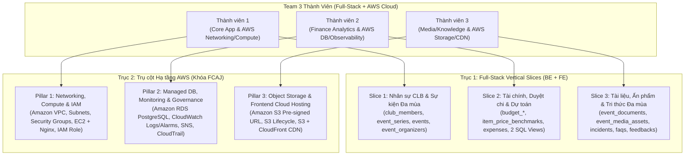

# Danh Sách Tính Năng & Phân Chia Công Việc — Phiên Bản V2 (Định Hướng Full-Stack & AWS FCAJ)

Tài liệu này là phiên bản nâng cấp (**V2**) của bảng phân công công việc cho **Team 3 Thành Viên Full-Stack**, được tối ưu hóa riêng cho mục tiêu học tập, thực hành triển khai hạ tầng đám mây **Amazon Web Services (AWS — Chương trình FCAJ)**.

Mỗi thành viên sẽ làm chủ song song **2 trục trách nhiệm (Dual-Axis Ownership)**:
1. **Trục Ứng dụng (Full-Stack Vertical Slice)**: Tự chủ hoàn toàn từ **Database Schema (Supabase/PostgreSQL)** $\rightarrow$ **Backend REST API (Spring Boot 3)** $\rightarrow$ **Frontend UI (React 19 + TypeScript + Vite)**.
2. **Trục Hạ tầng Đám mây (AWS Cloud Pillar - FCAJ)**: Mỗi thành viên chịu trách nhiệm thiết kế, triển khai và viết báo cáo/workshop cho một trụ cột dịch vụ AWS riêng biệt, đảm bảo **cả 3 người đều có trải nghiệm thực chiến sâu với AWS** và có nội dung bảo vệ độc lập.

---

## 1. Sơ Đồ Tổng Quan Phân Bổ (Full-Stack + AWS Pillars)

---

## 2. Giai Đoạn Khởi Đầu (Phase 0 — Shared Foundation)

Để tránh nút cổ chai (bottleneck) khi cả 3 thành viên cùng code Full-Stack song song trong tuần đầu tiên, các hạng mục nền tảng dùng chung được chia đều cho 3 người trước khi đi sâu vào từng phân hệ:

| Thành viên | Hạng mục Khởi tạo Nền tảng Dùng chung (Phase 0) | Đầu ra bàn giao cho cả nhóm (Deliverables) |
| :--- | :--- | :--- |
| **Thành viên 1** | **Backend Core & Database Schema** | - Quản lý lược đồ CSDL qua **Supabase Migration** (`V1__init_schema.sql`). - Cấu hình `common.response` (`ApiResponse<T>`), `common.exception` (`GlobalExceptionHandler`), các Enum dùng chung và cấu hình CORS / Spring Security cơ bản. |
| **Thành viên 2** | **Frontend Core & App Shell** | - Dựng bộ khung `frontend/src/`: Cấu hình `react-router-dom`, HTTP Client (`services/apiClient.ts` kèm interceptors), khung giao diện chính (`MainLayout`, `Sidebar`, `Header`). - Xây dựng `ActiveEventContext` (cho phép chọn Mùa sự kiện đang làm việc để các trang của cả 3 thành viên lấy được `eventId` hiện hành). |
| **Thành viên 3** | **Shared S3 Storage Service (BE + FE)** | - Xây dựng module `com.projectf.features.storage` sử dụng **AWS SDK v2 (`S3Presigner`)** sinh Pre-signed PUT/GET URL (kiểm tra kích thước $\le 15\text{MB}$ cho hóa đơn, $\le 50\text{MB}$ cho tài liệu). - Xây dựng custom hook `useS3Upload` và component `FileUploader` trên Frontend để Thành viên 2 (upload hóa đơn `expense_receipts`) và Thành viên 3 (tài liệu, ấn phẩm, khảo sát) tái sử dụng. |

---

## 3. Bảng Phân Công Chi Tiết (Full-Stack Vertical Slices & AWS FCAJ)

| Thành viên | Trụ cột Hạ tầng AWS (FCAJ Cloud Pillar) | Các Bảng / Views Phụ trách | Backend Packages (`com.projectf.*`) | Frontend Pages & Modules (`frontend/src/*`) | Chi tiết Công việc (Full-Stack + AWS Tasks) |
| :--- | :--- | :--- | :--- | :--- | :--- |
| **Thành viên 1** *(Core App & AWS Network/Compute)* | **Networking, Compute & Security:** - `Amazon VPC` (Public/Private Subnets, IGW, Route Tables) - `Security Groups` - `Amazon EC2` (Nginx Reverse Proxy + SSL) - `AWS IAM` (Roles & Instance Profile) | - `club_members` - `event_series` - `events` - `event_organizers` | - `common.config` - `common.security` - `features.member` - `features.event` | - `pages/members/*` (Danh sách, hồ sơ thành viên, phân ban) - `pages/events/*` (Chuỗi sự kiện, tạo/cập nhật mùa sự kiện, quản lý quỹ cấp phát) - `pages/organizers/*` (Phân công BTC & vai trò sự kiện) | **1. AWS Cloud (FCAJ):** - Thiết kế mạng VPC chuẩn đa tầng (Public Subnet cho EC2, Private Subnet cho RDS). - Thiết lập Security Groups theo nguyên tắc *Least Privilege* và gắn IAM Role cho EC2. - Triển khai Backend Spring Boot lên EC2 kèm Nginx Reverse Proxy. **2. Full-Stack Feature:** - Xây dựng API + Giao diện quản lý Thành viên CLB (`club_members`), lọc theo ban (`department_enum`) và khóa (`batch`). - Xây dựng API + Giao diện quản lý Chuỗi sự kiện (`event_series`), Mùa sự kiện (`events`) và Phân công nhân sự BTC (`event_organizers`). |
| **Thành viên 2** *(Finance Analytics & AWS DB/Monitoring)* | **Managed DB, Monitoring & Governance:** - `Amazon RDS for PostgreSQL 15+` (Multi-AZ / Backups & Snapshots) - `Amazon CloudWatch` (Logs, Metrics, Dashboards, Alarms) - `Amazon SNS` (Email Alerts) - `AWS CloudTrail` | - `budget_categories` - `item_price_benchmarks` - `budget_items` - `expenses` - `expense_receipts` - `v_event_budget_summary` - `v_projected_budget_from_previous_season` | - `features.finance` *(hoặc tách nhỏ: `budget`, `expense`, `benchmark`)* | - `pages/finance/dashboard/*` (Dashboard ngân sách thời gian thực & biểu đồ chênh lệch) - `pages/finance/benchmarks/*` (Master Catalog & bảng giá thị trường) - `pages/finance/budgets/*` (Lập/duyệt dự trù & kế thừa tự động mùa trước) - `pages/finance/expenses/*` (Thực chi, đính kèm hóa đơn S3 & duyệt chi) | **1. AWS Cloud (FCAJ):** - Khởi tạo & tối ưu hóa Amazon RDS PostgreSQL trong Private Subnet, cấu hình Automated Backups & Snapshot. - Cài đặt CloudWatch Agent thu thập log/metric từ EC2 & RDS; dựng CloudWatch Dashboard. - Thiết lập CloudWatch Alarms kết hợp Amazon SNS gửi cảnh báo tự động khi lỗi `5xx` hoặc quá tải tài nguyên; bật CloudTrail kiểm vết. **2. Full-Stack Feature:** - Xây dựng CRUD + UI cho Danh mục chi (`budget_categories`) và Bảng giá chuẩn (`item_price_benchmarks`). - Xây dựng luồng lập/phê duyệt Dự trù (`budget_items`) và Thực chi kèm hóa đơn (`expenses`, `expense_receipts`). - Ánh xạ 2 Read-only Views (`@Immutable`) làm Dashboard ngân sách thời gian thực và tính năng kế thừa dự toán tự động sang mùa mới. |
| **Thành viên 3** *(Media/Knowledge & AWS Storage/CDN)* | **Object Storage & Frontend Delivery:** - `Amazon S3` (Storage Bucket, Block Public Access, CORS, Bucket Policy) - `S3 Lifecycle Rules` (Standard $\rightarrow$ IA/Glacier) - `AWS SDK v2` (Pre-signed URLs) - `Amazon CloudFront + S3` *(hoặc AWS Amplify)* cho Frontend Hosting | - `event_documents` - `event_media_assets` - `event_incidents` - `event_faqs` - `event_feedbacks` | - `features.storage` - `features.document` - `features.media` - `features.knowledge` | - `components/common/FileUploader.tsx` (Upload trực tiếp S3 qua Pre-signed URL) - `pages/documents/*` (Quản lý tài liệu kế hoạch, lịch sử phiên bản & duyệt) - `pages/media/*` (Quản lý ấn phẩm truyền thông & trạng thái in ấn) - `pages/knowledge/*` (Nhật ký sự cố Post-Mortem, Kho FAQ đa mùa & Khảo sát động `JSONB`) | **1. AWS Cloud (FCAJ):** - Thiết lập S3 Bucket bảo mật (chặn Public Access), cấu hình CORS và chính sách **S3 Lifecycle** lưu trữ lạnh cho dữ liệu các mùa sự kiện cũ. - Triển khai dịch vụ sinh Pre-signed URL (`S3Presigner`) dùng chung cho toàn dự án. - Triển khai (Deploy) ứng dụng Frontend React/Vite lên **Amazon S3 Static Hosting + Amazon CloudFront CDN** (kèm HTTPS). **2. Full-Stack Feature:** - Xây dựng API + UI cho Tài liệu kế hoạch (`event_documents` có cây phiên bản `parent_document_id`) và Ấn phẩm thiết kế (`event_media_assets`). - Xây dựng API + UI cho Nhật ký sự cố (`department_enum[]`), Kho FAQ đa mùa (`is_pinned`) và Khảo sát sự kiện (`custom_responses` kiểu `JSONB`). |

---

## 4. Quy Ước Phối Hợp Giữa Các Thành Viên (Cross-Slice Contracts)

Để 3 thành viên làm việc độc lập trên các nhánh Git mà không làm gãy code của nhau:

1. **Quy ước liên kết khóa ngoại chéo giữa các Feature Package (`UUID Reference Only`)**:
   - Các bảng của **Thành viên 2** và **Thành viên 3** khi tham chiếu tới `events(id)` hoặc `club_members(id)` của **Thành viên 1** (hoặc `budget_items.media_asset` tham chiếu tới `event_media_assets(id)`) ưu tiên khai báo dưới dạng trường khóa ngoại đơn giản (`@Column(name = "event_id", nullable = false) private UUID eventId;`) thay vì gắn `@ManyToOne` phức tạp chéo package ngay từ đầu. Điều này giúp từng Vertical Slice có thể viết Unit/Integration Test và chạy độc lập.
2. **Quy ước sử dụng dịch vụ lưu trữ S3 (`features.storage`)**:
   - Mọi bảng có đính kèm tệp (`expense_receipts.image_url` của **Thành viên 2**; `event_documents.file_url`, `event_media_assets.design_file_url`, `event_feedbacks.file_url` của **Thành viên 3**) đều gọi chung một endpoint tạo Pre-signed URL do **Thành viên 3** cung cấp (`POST /api/v1/storage/presigned-upload`) với tham số `category` (`RECEIPT`, `DOCUMENT`, `MEDIA`, `FEEDBACK`).
3. **Quy ước phân chia Router & Menu trên Frontend (`frontend/src/`)**:
   - Mỗi phân hệ định nghĩa mảng route riêng trong file cấu hình của phân hệ đó và chỉ import vào `App.tsx` để hạn chế tối đa xung đột merge (merge conflict).

---

## 5. Đầu Ra Báo Cáo / Workshop Khóa FCAJ Cho Từng Thành Viên

Với cách phân bổ trên, khi tổng kết dự án **FCAJ**, nhóm sẽ có bộ tài liệu triển khai AWS hoàn chỉnh gồm **3 phần nối tiếp nhau**:

1. **Phần 1 (Thành viên 1 trình bày)**: Thiết kế kiến trúc mạng **Amazon VPC** an toàn, phân tách Public/Private Subnet, thiết lập **IAM Role** chuẩn bảo mật và triển khai Backend lên **Amazon EC2 + Nginx**.
2. **Phần 2 (Thành viên 2 trình bày)**: Triển khai cơ sở dữ liệu **Amazon RDS for PostgreSQL** trong Private Subnet, chiến lược sao lưu phục hồi (Backup/Snapshot), giám sát tập trung với **Amazon CloudWatch**, cảnh báo tự động qua **Amazon SNS** và kiểm toán hạ tầng bằng **AWS CloudTrail**.
3. **Phần 3 (Thành viên 3 trình bày)**: Kiến trúc lưu trữ tệp phân tán trên **Amazon S3** với cơ chế **Pre-signed URL** giảm tải cho Backend Server, tối ưu chi phí bằng **S3 Lifecycle Policy**, và phân phối ứng dụng Frontend toàn cầu qua **Amazon S3 + Amazon CloudFront CDN**.
