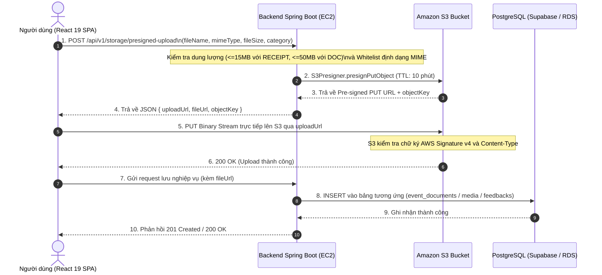

# Hướng Dẫn Báo Cáo & Workshop AWS FCAJ — Trụ Cột 3: Object Storage & Frontend CDN

Tài liệu này là nội dung báo cáo và thuyết trình độc lập dành riêng cho **Thành viên 3** trong chương trình **AWS Cloud (FCAJ)** của đồ án **Project F**.

---

## 1. Thông Tin Trụ Cột Đảm Nhiệm (Dual-Axis Ownership)

- **Người thực hiện**: Thành viên 3
- **Chuyên đề AWS FCAJ (Trục 2)**: **Pillar 3 — Cloud Object Storage & Global Frontend Delivery**
- **Dịch vụ AWS sử dụng**:
  - `Amazon S3` (Storage Bucket, Block Public Access, CORS, Bucket Policy, S3 Lifecycle Rules).
  - `AWS SDK v2 (Java / S3Presigner)` (Cơ chế Pre-signed PUT/GET URLs phân quyền có thời hạn).
  - `Amazon CloudFront` (Content Delivery Network - CDN phân phối giao diện SPA toàn cầu kèm HTTPS).
- **Phân hệ ứng dụng thực chiến (Trục 1)**:
  - Vertical Slice 3: Quản lý Tài liệu đề án (`event_documents`), Ấn phẩm truyền thông (`event_media_assets`), Nhật ký sự cố Post-Mortem (`event_incidents`), Ngân hàng FAQ đa mùa (`event_faqs`), và Khảo sát đánh giá (`event_feedbacks`).
  - Nền tảng dùng chung: Bộ dịch vụ S3 Pre-signed URL (`useS3Upload`, `FileUploader.tsx`) cung cấp cho Thành viên 2 (Hóa đơn thực chi) và toàn bộ dự án.

---

## 2. Kiến Trúc & Sơ Đồ Luồng Hoạt Động (Architecture & Flow)

### 2.1. So sánh Kiến trúc Tải tệp: Truyền thống vs S3 Pre-signed URL

| Tiêu chí | Mô hình truyền thống (Qua Backend Server) | Mô hình Project F (Amazon S3 Pre-signed URL) |
| :--- | :--- | :--- |
| **Băng thông Backend EC2** | Phải tải tệp 2 lần: Client $\rightarrow$ EC2 $\rightarrow$ S3 (Tốn gấp đôi bandwidth). | Tệp đi thẳng từ Trình duyệt $\rightarrow$ S3. Băng thông EC2 tiêu thụ $\approx 0\text{ MB}$. |
| **Bộ nhớ (RAM / Heap)** | Dễ gây lỗi `OutOfMemoryError` khi nhiều người cùng upload tệp lớn (50MB). | Backend chỉ sinh chuỗi URL JSON nhỏ (<1KB), RAM máy chủ luôn ở mức ổn định. |
| **Tải CPU máy chủ** | CPU cao do phải đọc buffer stream liên tục. | CPU rảnh rỗi tập trung xử lý nghiệp vụ phê duyệt và dữ liệu quan hệ. |
| **Bảo mật truy cập** | Phải mở công khai S3 hoặc proxy qua server. | Bucket đóng kín (*Block Public Access*), chỉ cấp quyền qua URL có chữ ký mã hóa (TTL 10-15 phút). |

### 2.2. Sơ đồ tuần tự Pre-signed URL Upload

---

## 3. Cấu Hình Hạ Tầng AWS Thực Chiến (Implementation Specs)

### 3.1. Cấu hình Bảo mật S3 Bucket (Block Public Access & CORS)
1. **Block Public Access**: Bật tất cả 4 tùy chọn chặn truy cập công khai của Bucket. Tuyệt đối không public bucket ra internet.
2. **Cấu hình CORS (Cross-Origin Resource Sharing)**:
   Để trình duyệt cho phép upload trực tiếp từ React SPA lên link S3 Pre-signed URL:
   - Cho phép các Method: `PUT`, `GET`, `HEAD`.
   - Cho phép Origins: `http://localhost:5173` (dev) và `https://*.cloudfront.net` (production).
   - Expose Headers: `ETag`.

*(Xem chi tiết file mẫu tại [docs/aws/s3-cors-policy.json](file:///C:/Users/Nguyen%20Xuan%20Tan/FPTU/S6/AWS/Project-F/docs/aws/s3-cors-policy.json))*.

### 3.2. Chính sách Vòng đời Dữ liệu S3 (S3 Lifecycle Rules)
Để tối ưu hóa ngân sách tài nguyên đám mây qua các nhiệm kỳ CLB:
- **Sau 30 ngày**: Tệp tự động chuyển từ `Standard` sang **S3 Standard-IA** (Infrequent Access) — Tiết kiệm ~40% chi phí lưu trữ.
- **Sau 90 ngày**: Tệp tự động chuyển sang **S3 Glacier Flexible Retrieval** — Tiết kiệm ~80% chi phí cho các mùa sự kiện đã kết thúc (`COMPLETED`).
- **Sau 7 ngày**: Tự động hủy các phiên upload multipart chưa hoàn tất (`AbortIncompleteMultipartUpload`).

*(Xem chi tiết file mẫu tại [docs/aws/s3-lifecycle-rule.json](file:///C:/Users/Nguyen%20Xuan%20Tan/FPTU/S6/AWS/Project-F/docs/aws/s3-lifecycle-rule.json))*.

### 3.3. Phân Phối Giao Diện Tĩnh (Amazon S3 Static Hosting + CloudFront CDN)
1. **Build Artifacts**: Đóng gói Frontend bằng lệnh `npm run build` tạo ra thư mục tĩnh `frontend/dist/`.
2. **Amazon S3 Origin**: Đồng bộ thư mục `dist/` lên S3 Bucket đóng kín.
3. **Amazon CloudFront Distribution**:
   - Sử dụng **Origin Access Control (OAC)** để CloudFront truy cập an toàn vào S3 Bucket mà không cần mở public.
   - Bật nén **Gzip & Brotli**.
   - Cung cấp chứng chỉ SSL/TLS miễn phí qua **AWS Certificate Manager (ACM)**.
4. **Cấu hình Single Page Application (SPA Router Fix)**:
   - Trong CloudFront: Cấu hình **Custom Error Responses**:
     - *HTTP Error Code*: `403` và `404`
     - *Customize Error Response*: `Yes`
     - *Response Page Path*: `/index.html`
     - *HTTP Response Code*: `200: OK`
   - Điều này đảm bảo khi người dùng tải lại trang tại URL `/events/ev-tech-fall-2026/documents`, CloudFront vẫn trả về file `index.html` để React Router xử lý định tuyến phía client.

---

## 4. Kịch Bản Trình Diễn Demo Tại Workshop (5 Bước Thực Chiến)

1. **Bước 1 — Trình diễn FileUploader & Kiểm soát dung lượng tại Client**:
   - Mở màn hình Tài liệu hoặc Khảo sát.
   - Thử kéo thả tệp > 50MB $\rightarrow$ Hệ thống lập tức chặn và báo lỗi màu đỏ ngay tại client.
2. **Bước 2 — Trình diễn Luồng S3 Pre-signed URL trên Network Tab**:
   - Mở DevTools Network $\rightarrow$ Chọn tệp PDF kế hoạch 5MB.
   - Chỉ ra request `POST /api/v1/storage/presigned-upload` nhận URL có tham số bảo mật `X-Amz-Signature`.
   - Chỉ ra request tiếp theo là `PUT` gửi trực tiếp tới `*.s3.ap-southeast-1.amazonaws.com` với mã `200 OK`.
3. **Bước 3 — Quản lý Phiên bản Tài liệu & Cây phả hệ**:
   - Tạo phiên bản v1.0 $\rightarrow$ Tạo phiên bản mới v1.1 kế thừa v1.0.
   - Nhấn icon "Cây phả hệ" để người xem thấy sự liên kết giữa các thế hệ văn bản.
4. **Bước 4 — Nhật ký sự cố Post-Mortem & FAQ tích lũy**:
   - Trình bày 4 bước phân tích sự cố: Hiện tượng $\rightarrow$ Nguyên nhân cốt lõi $\rightarrow$ Xử lý tức thời $\rightarrow$ Bài học mùa sau.
   - Thao tác ghim câu hỏi FAQ lên đầu trang.
5. **Bước 5 — Trình bày Bảng thống kê Khảo sát Động JSONB**:
   - Thể hiện biểu đồ thanh đo 1-5 sao và dữ liệu JSONB mở rộng được hiển thị linh hoạt mà không cần thay đổi cấu trúc bảng CSDL.
